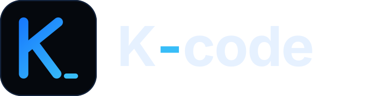

<p align="center">
  
</p>

<p align="center"><strong>The open GUI for your coding agents.</strong></p>

<p align="center">
  Run Claude Code, Codex, Cursor, Oh My Pi, OpenCode and more from one fast app — on desktop, in the browser, or from your phone.
</p>

<p align="center">
  <a href="https://kcode.agentbox.io.vn">Website</a> ·
  <a href="https://github.com/zt-hky/k-code/releases/latest">Download</a> ·
  <a href="./docs/user/install.md">Docs</a> ·
  Part of the <a href="https://agentbox.io.vn">AgentBox</a> family
</p>

---

K-code is an agent harness control surface. It drives the coding agents already installed on your machine, with your own subscriptions and logins, and gives you one place to start threads, watch them work, review changes, and run commands.

## Features

- **Many agents, one app.** Claude Code, Codex, Cursor, Grok Build, OpenCode, Google Antigravity, and any ACP agent.
- **Oh My Pi, first class.** Oh My Pi (`omp`) sessions, models, thinking levels and subagents are supported directly, not through a lowest-common-denominator shim.
- **Agent Hub.** See every running agent and subagent in a live grid: current tool, progress, latest thinking, and replies, with room for as many panes as you have agents.
- **Stop a single subagent.** Cancel one subagent without ending the whole turn, on agents that support it.
- **Full transcript mode.** Switch on complete thinking and complete tool input and output, with no folds or truncation, when you need to audit exactly what an agent did.
- **Resume sessions.** Pick up conversations that live in an agent's own session store, including ones started outside K-code.
- **Settings sync.** Appearance and client preferences follow you across your connected environments.
- **Remote and mobile.** Reach your machine from a browser or phone, see [remote access](./docs/user/remote-access.md).
- **Real developer tooling.** Git worktrees, diff review, terminals, an in-app browser, pull request integration, keyboard-first navigation.
- **Ocean blue on black.** A dark-first theme tuned for long sessions, with a matching light variant. Other themes stay one click away.

## Installation

Install and authenticate at least one agent before use:

- Codex: install [Codex CLI](https://developers.openai.com/codex/cli) and run `codex login`
- Claude: install [Claude Code](https://claude.com/product/claude-code) and run `claude auth login`
- Cursor: install [Cursor CLI](https://cursor.com/cli) and run `agent login`
- Grok Build: install [Grok Build CLI](https://x.ai/cli) and run `grok login`
- OpenCode: install [OpenCode](https://opencode.ai) and run `opencode auth login`
- Oh My Pi: install [Oh My Pi](https://github.com/can1357/oh-my-pi) and sign in with `omp`
- Antigravity: enable it in Settings, then use **Install Antigravity** and **Sign in with Google**. No CLI is required.

### Command line

Linux and macOS:

```bash
curl -fsSL https://kcode.agentbox.io.vn/install.sh | sh
```

Windows, in PowerShell:

```powershell
irm https://kcode.agentbox.io.vn/install.ps1 | iex
```

Then run `kcode` to start the server and open the local web app. `kcode service install` keeps it running in the background and `kcode --help` has the full reference.

### Desktop app

Download the installer for your platform from [GitHub Releases](https://github.com/zt-hky/k-code/releases/latest):

| Platform         | Download                                                                                                                 |
| ---------------- | ------------------------------------------------------------------------------------------------------------------------ |
| Linux (AppImage) | [`K-code-linux-x86_64.AppImage`](https://github.com/zt-hky/k-code/releases/latest/download/K-code-linux-x86_64.AppImage) |
| Debian, Ubuntu   | [`K-code-linux-amd64.deb`](https://github.com/zt-hky/k-code/releases/latest/download/K-code-linux-amd64.deb)             |
| Windows          | [`K-code-windows-x64-setup.exe`](https://github.com/zt-hky/k-code/releases/latest/download/K-code-windows-x64-setup.exe) |
| macOS (Apple)    | [`K-code-macos-arm64.dmg`](https://github.com/zt-hky/k-code/releases/latest/download/K-code-macos-arm64.dmg)             |
| macOS (Intel)    | [`K-code-macos-x64.dmg`](https://github.com/zt-hky/k-code/releases/latest/download/K-code-macos-x64.dmg)                 |

Checksums are published in `SHA256SUMS.txt` on every release. Builds are unsigned unless noted otherwise on the release page.

On Debian or Ubuntu: `sudo apt install ./K-code-linux-amd64.deb`.

## Run from source

K-code uses [Vite+](https://viteplus.dev/guide/), so install the global `vp` tool first.

```bash
# macOS / Linux
curl -fsSL https://vite.plus | bash
```

```powershell
# Windows
irm https://vite.plus/ps1 | iex
```

Then:

```bash
vp i
npm run dev
```

`npm run dev` starts the contracts watcher, the web app (Vite) and the server together and prints the ports it chose. Open the pairing URL it prints to connect the browser.

Building from source in depth: [docs/internals/overview.md](./docs/internals/overview.md).

## Documentation

Docs live in [docs/](./docs).

- [FAQ](./docs/user/faq.md)
- [Install and first run](./docs/user/install.md)
- [Permission modes](./docs/user/permission-modes.md)
- [Keyboard shortcuts](./docs/user/keybindings.md)
- [Project settings](./docs/user/project-settings.md)
- [Appearance preferences](./docs/user/appearance.md)
- [Remote access from a phone or another machine](./docs/user/remote-access.md)
- [Connect Claude Code, Codex, ChatGPT and other agents over MCP](./docs/user/outside-agents.md)
- [Keeping app and server in sync](./docs/user/updating.md)
- [Source control integrations](./docs/user/source-control.md)
- Multiple accounts: [Codex](./docs/user/providers-codex.md) · [Claude](./docs/user/providers-claude.md)
- [Oh My Pi](./docs/user/providers-ohmypi.md)
- [Run K-code as a background service](./docs/user/background-service.md)

## Contributing

Read [CONTRIBUTING.md](./CONTRIBUTING.md) before reporting a bug or opening a PR. Report issues at [github.com/zt-hky/k-code/issues](https://github.com/zt-hky/k-code/issues).

## Credits and license

K-code is based on [T3 Code](https://github.com/pingdotgg/t3code) by T3 Tools Inc. (MIT), and is part of the [AgentBox](https://agentbox.io.vn) family.

Released under the [MIT License](./LICENSE). Copyright (c) 2026 T3 Tools Inc. and (c) 2026 zt-hky (K-code).
